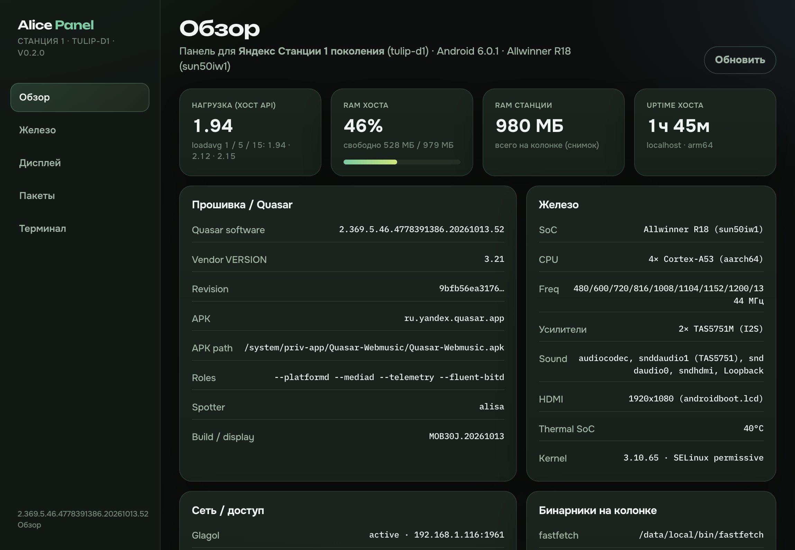
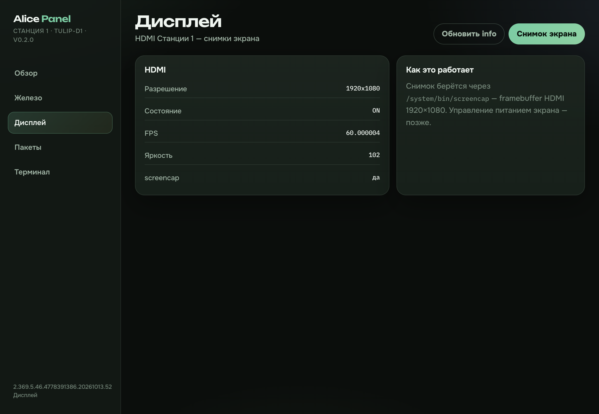
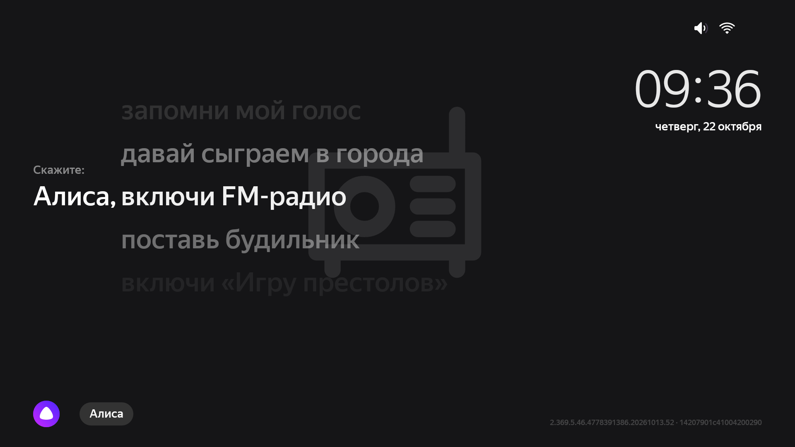
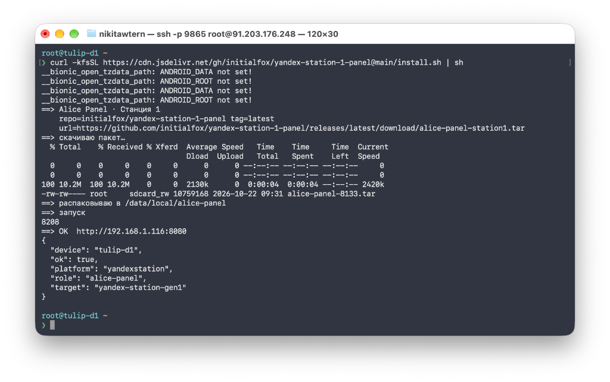

# Alice Panel — Яндекс Станция 1

Веб-панель для **Яндекс Станции 1 поколения** (`tulip-d1` / `yandexstation` / aarch64).

Один бинарь `alice-httpd` на колонке, без Node. Актуальная версия: **v0.2.0**.



---

## Возможности

### Обзор
- Модель и железо: Allwinner R18, Android 6.0.1, HDMI 1920×1080
- Прошивка Quasar: software / vendor / revision, APK, roles, spotter
- Живые метрики хоста: loadavg, RAM, uptime
- Сеть и доступ: Glagol, SSH (dropbear), ADB

### Железо
- SoC, CPU (Cortex-A53 ×4), частоты
- I2C (усилители tas5751m и др.)
- Модули ядра, разделы накопителя, inputs
- Thermal / SELinux / locale

### Дисплей
- Инфо по HDMI (разрешение, state, fps, яркость)
- **Снимки экрана** через `screencap` (framebuffer 1920×1080)





### Пакеты
- Установка aarch64-бинарников в `/data/local/bin`
- **zsh** ставится сразу при установке панели
- В UI: **fastfetch** и переустановка

### Терминал
- Веб-шелл в браузере (xterm + PTY)

### Автообновление
- При открытии панели проверяется GitHub Releases
- Если есть новая версия — баннер и кнопка **Обновить**
- Обновление само переустанавливает панель на колонке (`install.sh`)

Файлы: `/data/local/alice-panel/` · лог: `httpd.log` · рестарт: `sh /data/local/alice-panel/start.sh`

---

## Root

Нужен **root**. Как получить на Станции 1:

https://t.me/c/4457409211/1710/6152

---

## Установка (SSH)

```sh
curl -kfsSL https://cdn.jsdelivr.net/gh/initialfox/yandex-station-1-panel@main/install.sh | sh
```

`-k` обязателен: у системного curl нет CA.



### После установки

Скрипт сам напишет адрес:

```text
==> панель запущена
    открой в браузере (та же Wi‑Fi, что и колонка):
    http://192.168.1.116:8080
```

Открой **IP колонки :8080** в браузере в той же Wi‑Fi.

---

## Разработка

```bash
cd httpd && ./build.sh
cd ../web && npm i && npm run build
bash scripts/pack-release.sh
```
